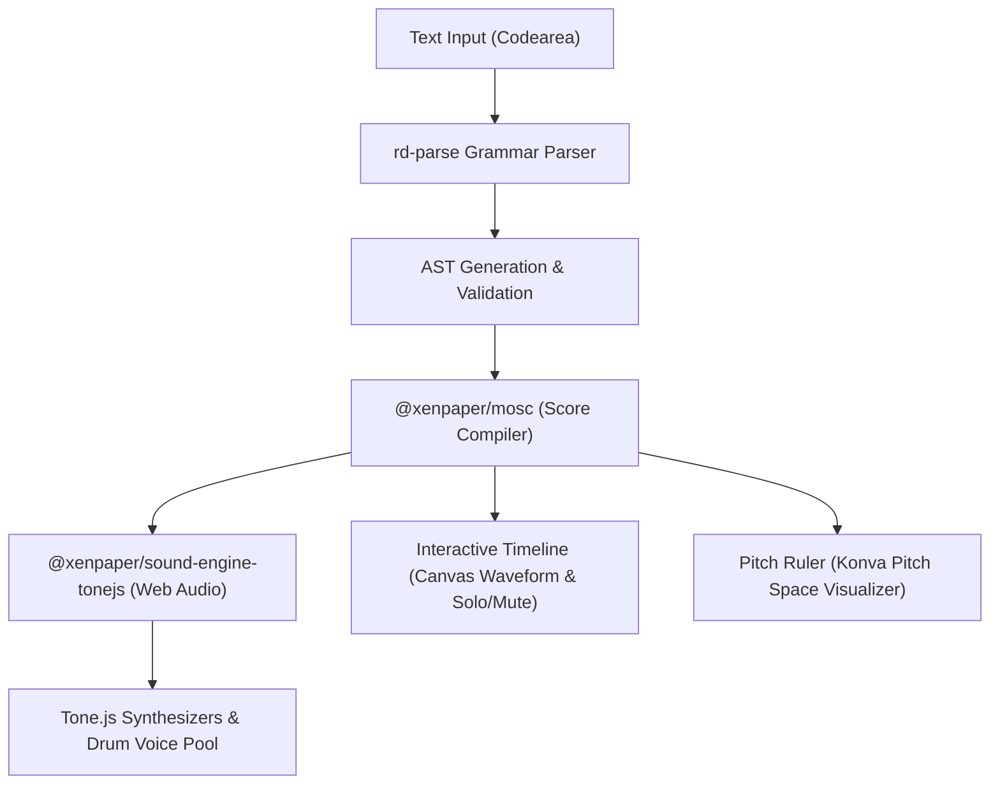

<div align="center">

# Xenpaper

**An interactive, text-based microtonal music sequencer and scratchpad in the browser.**

[](https://github.com/mochiron-desu/xenpaper/actions/workflows/deploy.yml)
[](LICENSE)
[](package.json)
[](https://tonejs.github.io/)
[](https://mochiron-desu.github.io/xenpaper/)

[**Live Demo**](https://mochiron-desu.github.io/xenpaper/) · [**Upstream Project**](https://dxinteractive.github.io/xenpaper/) · [**Report Issue**](https://github.com/mochiron-desu/xenpaper/issues)

</div>

---

## Table of Contents

- [About Xenpaper](#about-xenpaper)
- [Key Features](#key-features)
- [Notation & Syntax Quick Reference](#notation--syntax-quick-reference)
  - [Notes & Pitch Representations](#notes--pitch-representations)
  - [Rhythm, Timing & Structure](#rhythm-timing--structure)
  - [Scales & Tunings](#scales--tunings)
  - [Percussion & Drum Machine](#percussion--drum-machine)
  - [Synthesizer & Sound Controls](#synthesizer--sound-controls)
  - [Multi-Track Sequencing](#multi-track-sequencing)
  - [Keyboard Shortcuts](#keyboard-shortcuts)
- [Architecture & Monorepo](#architecture--monorepo)
- [Quick Start](#quick-start)
  - [Prerequisites](#prerequisites)
  - [Installation & Setup](#installation--setup)
  - [Available Scripts](#available-scripts)
- [Origins & Attribution](#origins--attribution)
- [License](#license)

---

## About Xenpaper

**Xenpaper** is a browser-based, text-first music sequencer designed specifically for exploring **xenharmonic (microtonal) music**.

Traditional music notation software and conventional DAWs are strictly oriented around 12-tone equal temperament (12-EDO). Exploring alternative tunings, just intonation intervals, custom scales, or exotic equal divisions is frequently cumbersome. 

With Xenpaper, you write music as human-readable text:
* Enter scale degrees, ratios, cents, or steps of equal temperaments.
* Define custom scales or temperaments on the fly (`19edo`, `31edo`, `13ed3`, or custom ratios like `4:5:6:7`).
* Hear your music rendered instantly using a polyphonic Web Audio synthesis engine powered by [Tone.js](https://tonejs.github.io/).
* Share complete songs via zero-backend, state-encoded URL hashes or embed them into any webpage.

---

## Key Features

- **Expressive Microtonal Notation**
  - Scale degrees starting from zero (`0 2 4 7`)
  - Just Intonation frequency ratios (`3/2`, `5/4`, `1/1`, `10:12:15`)
  - Precise cents (`702c`, `1200c`)
  - EDO steps (`11\19`, `7\31`) and arbitrary equaves (`5\13o3`)
  - Absolute frequencies in Hertz (`432Hz`, `220Hz`)
  - Octave shifting markers (`'` up 1 octave, `"` up 2 octaves, `` ` `` down 1 octave)

- **Flexible Tuning & Scale Systems**
  - Switch scales at any point in the composition (e.g. `{19edo}`, `{31edo}`, `{13ed3}`)
  - Custom rational scales and harmonic series segments (`{4::7}`)
  - Prime retunings for just intonation ratios (`(primes: 12 19 28 34)`)
  - Dynamic root note changes (`{r432Hz}`, `{r'0}`)

- **Built-in Percussion & Drum Machine**
  - Expressive drum voices: `kick`/`bd`, `snare`/`sd`, `hat`/`hh`, `openhat`/`oh`, `clap`/`cp`, `tom`/`lotom`/`hitom`, `crash`/`cr`, `ride`/`rd`, `rim`, `cowbell`/`cb`, `shaker`
  - Layered drum chords (e.g. `[kick,hh]`, `[snare,oh]`) and holds (`kick---`)
  - Dedicated drum machine track mode with `(inst:drums)` mapping numeric degrees `0`–`9` directly to drum kit pieces

- **Multi-Track Polyphonic Synthesizer**
  - Layer independent musical lines with `(track:name)` / `(t:name)`
  - Flexible oscillator types: `sine`, `triangle`, `sawtooth`, `square`, with `fat`, `fm`, and `am` modifiers
  - 4-digit ADSR envelope control `(env:2856)` and per-track volume controls `(vol:0.8)`

- **Interactive Visual Timeline & Pitch Ruler**
  - **Timeline:** Canvas-rendered overview scrubber with track-colored note density, time indicators, and Solo / Mute toggles
  - **Pitch Ruler:** Interactive canvas/Konva pitch ruler displaying harmonic relationships, played notes, and scale plots with pan/zoom controls

- **Zero-Backend URL Sharing & Embeds**
  - The entire musical score is compressed and encoded into the URL hash
  - One-click copy for shareable links and responsive `<iframe>` embed codes

---

## Notation & Syntax Quick Reference

### Notes & Pitch Representations

| Syntax | Description | Example |
| :--- | :--- | :--- |
| `0`, `2`, `4` | Scale degree (0-indexed) | `0 4 7 12` |
| `3/2`, `5/4` | Frequency ratio (Just Intonation) | `1/1 5/4 3/2` |
| `702c`, `1200c` | Cents offset | `0c 702c 1200c` |
| `11\19` | EDO degree step (e.g., 11th step of 19-EDO) | `0\19 7\19 11\19` |
| `5\13o3` | Equal division of a custom equave (13 divisions of tritave 3/1) | `5\13o3` |
| `432Hz`, `220Hz` | Absolute frequency in Hertz | `220Hz 440Hz` |
| `'` / `"` / `` ` `` | Octave shift up (+1, +2) or down (-1) | `'0 "2 `0 ``0` |
| `[0,4,7]` | Polyphonic chord | `[0,4,7] [3,7,10]` |
| `4:5:6:7` | Colon-notated harmonic chord | `4:5:6---` |

### Rhythm, Timing & Structure

| Syntax | Description | Example |
| :--- | :--- | :--- |
| `-` | Note hold (extends duration by current subdivision) | `0---` |
| `.` | Rest (advances time by current subdivision) | `0 . 2 . 4 .` |
| `\|` | Bar line (structural visual delimiter) | `0 2 4 5 \| 7 9 11 12` |
| `#` | Single-line comment | `# Bassline starts here` |
| `(bpm:120)` | Tempo in beats per minute (default: 120) | `(bpm:140)` |
| `(bms:500)` | Tempo in milliseconds per beat | `(bms:800)` |
| `(div:4)` or `(4)` | Beat division / subdivisions per beat (default: 2) | `(div:4) 0 1 2 3 (div:2) 0 1` |

### Scales & Tunings

| Syntax | Description | Example |
| :--- | :--- | :--- |
| `{12edo}` / `{31edo}` | Equal division of the 2/1 octave | `{31edo} 0 5 10 18 26 31` |
| `{13ed3}` | Equal division of custom equave (13 divisions of 3/1) | `{13ed3} 0 1 2 3 4` |
| `{1/1 5/4 3/2}` | Scale defined by individual pitch ratios | `{1/1 9/8 5/4 4/3 3/2 5/3 15/8}` |
| `{4::7}` | Harmonic series segment (`4:5:6:7`) | `{4::7} 0 1 2 3` |
| `{m2 1 2 2 1 2 2}` | Scale mode definition (step intervals) | `{12edo}{m2 2 1 2 2 2 1}` |
| `{r432Hz}` / `{r2}` | Retune root pitch relative to current root | `{r432Hz} 0 4 7` |
| `(primes: ...)` | Retune prime factors for ratio notation | `(primes: 12 19 28 34)` |

### Percussion & Drum Machine

Percussion can be written as standalone tokens, grouped into rhythmic grooves, or played as chords:

```text
# Basic groove
kick . hat . snare . hat .
kick kick hat . snare . openhat .

# Polyphonic drum chords layered with melodic tracks
(track:drums)
[kick,hh] . hh . [snare,hh] . hh .
[kick,hh] kick hh . [snare,oh] . . .

# Drum machine mode (digits 0-9 map to kit elements)
(track:drums; inst:drums)
0 . 2 . 1 . 2 . 0 0 2 . 1 . 3 .
```

Supported percussion identifiers:
- `kick` / `bd` (Bass drum)
- `snare` / `sd` (Snare drum)
- `hat` / `hh` (Closed hi-hat)
- `openhat` / `oh` (Open hi-hat)
- `clap` / `cp` (Handclap)
- `tom` / `lotom` / `hitom` (Toms)
- `crash` / `cr` (Crash cymbal)
- `ride` / `rd` (Ride cymbal)
- `rim` (Rimshot)
- `cowbell` / `cb` (Cowbell)
- `shaker` (Shaker)

### Synthesizer & Sound Controls

Setters are enclosed in parentheses `(...)` and can be chained with semicolons `;`:

```text
(track:lead; osc:sawtooth; env:2856; vol:0.8)
```

| Parameter | Options / Format | Description |
| :--- | :--- | :--- |
| `osc:...` | `sine`, `triangle`, `sawtooth`, `square` (supports `fm`, `am`, `fat` prefixes, e.g. `fmsine`, `fatsawtooth`) | Oscillator waveform type |
| `env:...` | 4 digits: `[Attack][Decay][Sustain][Release]` (`0` = fast/short, `9` = slow/long). Default: `2856` | ADSR Envelope |
| `vol:...` / `v:...` | Float value (`1.0` = default, `0.0` = silent, `2.0` = boosted) | Track volume |
| `inst:...` | `synth` (default) or `drums` | Instrument mode |

### Multi-Track Sequencing

Use `(track:name)` or `(t:name)` to declare independent lines. Each track runs its own synthesizer voice starting at time zero:

```text
(bpm:130)

(track:bass; osc:sawtooth; env:1946; vol:0.9)
`0--- `5--- `7--- `0---

(track:lead; osc:triangle; env:2856; vol:0.7)
0 4 7 12 9 5 4 0 | 2 5 7 11 12---

(track:drums)
[kick,hh] . hh . [snare,hh] . hh .
```

### Keyboard Shortcuts

| Shortcut | Context | Action |
| :--- | :--- | :--- |
| `Space` | Outside editor | Play / Pause |
| `Ctrl` / `Cmd` + `Enter` | Any | Restart playback from current cursor line |
| `Ctrl` / `Cmd` / `Alt` + Click | Code editor | Play immediately from clicked note |
| `Ctrl` / `Cmd` + `/` | Code editor | Toggle comment on selected line(s) |
| `Ctrl` / `Cmd` + `Z` / `+ Shift` | Code editor | Undo / Redo |
| `←` / `→` | Timeline | Seek backward / forward by 5 seconds |
| `Home` / `End` | Timeline | Jump to score beginning / end |

---

## Architecture & Monorepo

The project is structured as a **Lerna monorepo** with Yarn workspaces:



### Workspace Packages

| Package | Path | Purpose |
| :--- | :--- | :--- |
| **`@xenpaper/xenpaper-app`** | [`packages/xenpaper-app`](packages/xenpaper-app) | React application bundle, CRA & Craco configuration, entry point, PWA assets. |
| **`@xenpaper/xenpaper-ui`** | [`packages/xenpaper-ui`](packages/xenpaper-ui) | Core UI library: text editor with syntax highlighting, timeline scrubber, pitch ruler canvas, and responsive sidebars. |
| **`@xenpaper/mosc`** | [`packages/mosc`](packages/mosc) | Music Object Score Compiler: converts AST tokens into millisecond event sequences, handles tuning math and pitch conversions. |
| **`@xenpaper/sound-engine-tonejs`** | [`packages/sound-engine-tonejs`](packages/sound-engine-tonejs) | Audio engine bridge built on Tone.js: voice pooling, synthesizer routing, dynamic parameter updating, and seeking. |

---

## Quick Start

### Prerequisites

- **Node.js**: `18.x` or higher recommended
- **Yarn**: `1.22.x` (Classic Yarn with Workspaces)

### Installation & Setup

1. **Clone the repository:**
   ```bash
   git clone https://github.com/mochiron-desu/xenpaper.git
   cd xenpaper
   ```

2. **Bootstrap dependencies:**
   ```bash
   yarn prep
   ```
   *(This installs root dependencies and runs `lerna bootstrap` to link all internal packages).*

### Available Scripts

Run from repository root:

- **Start Development Server:**
  ```bash
  yarn --cwd packages/xenpaper-app start
  # or
  cd packages/xenpaper-app && yarn start
  ```
  Opens [http://localhost:3000/xenpaper](http://localhost:3000/xenpaper) in your browser.

- **Run Tests:**
  ```bash
  yarn test
  ```
  Runs TypeScript type checking and Jest test suites across all packages.

- **Production Build:**
  ```bash
  yarn build
  ```
  Compiles the application into `packages/xenpaper-app/build` for static deployment.

- **Clean Reinstall:**
  ```bash
  yarn reinstall
  ```
  Removes all `node_modules` across the monorepo and re-bootstraps dependencies.

---

## Origins & Attribution

- **Original Creator**: Created by **Damien Clarke** ([@dxinteractive](https://github.com/dxinteractive)) as an open-source experiment to make microtonal notation audible in the browser.
- **Upstream Project**: [dxinteractive/xenpaper](https://github.com/dxinteractive/xenpaper) · [dxinteractive.github.io/xenpaper](https://dxinteractive.github.io/xenpaper/)
- **Active Fork**: Maintained at [mochiron-desu/xenpaper](https://github.com/mochiron-desu/xenpaper) with enhancements including polyphonic percussion pooling, responsive mobile navigation, interactive timeline scrubbing, track solo/muting, bar warnings, and updated CI/CD deployment pipelines.

---

## License

This project is licensed under the [MIT License](LICENSE) - see the [LICENSE](LICENSE) file for details.
